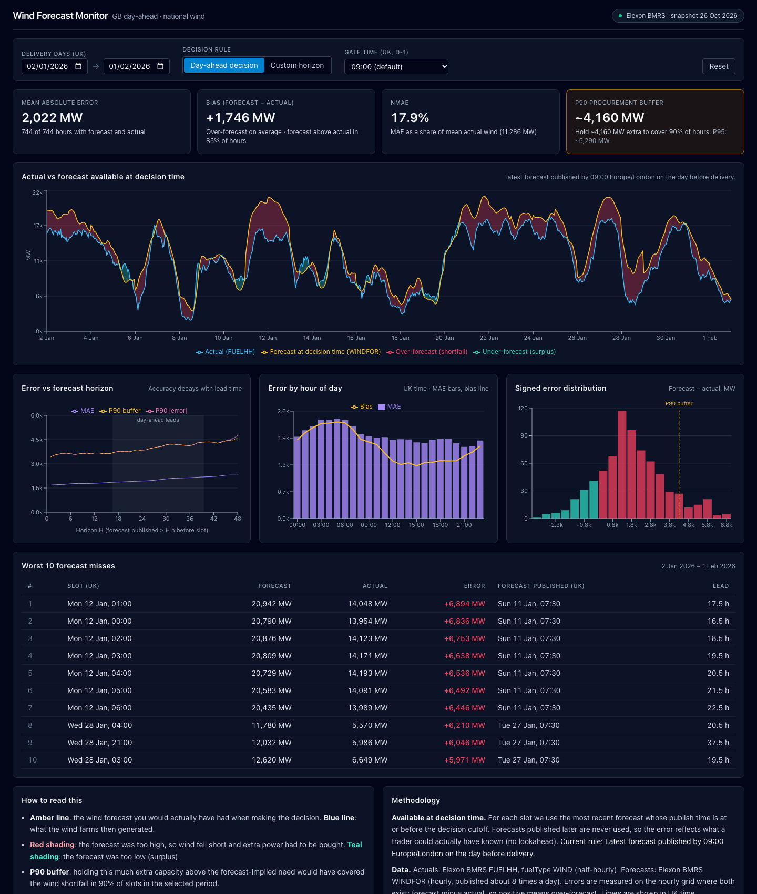
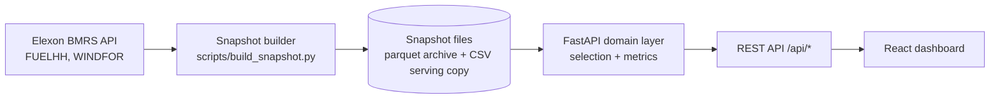

# Wind Forecast Monitor

A web app for a UK utility's day-ahead trading desk. For every hour of a delivery day it shows
the national wind forecast the desk actually had when it committed its day-ahead purchase,
next to what the wind fleet then generated, and turns the gap between the two into numbers
the desk can act on: average error, bias, how error grows with lead time, and a procurement
buffer ("hold about X MW extra to be covered in 90% of hours"). Data comes only from Elexon
BMRS (FUELHH wind outturn and WINDFOR forecasts) for purchase decisions made in January 2026.

**Live app:** https://reint-peach.vercel.app · **API docs:** https://reint-peach.vercel.app/api/docs



## Key findings (January 2026, day-ahead gate 09:00 UK)

Delivery days 2 Jan to 1 Feb 2026, 744 hours, every hour has both a forecast and an actual.

| | |
|---|---|
| Mean absolute error | **2,022 MW**, on an average output of 11,286 MW (nMAE 17.9%) |
| Bias | **+1,746 MW**: the forecast was above outturn in 85% of hours; only 4 of 31 days averaged below |
| P90 / P95 buffer | **~4,160 MW / ~5,290 MW** above the forecast-implied need |
| Lead time | MAE 1,685 MW at a 1 h horizon, 1,932 MW at 24 h, 2,301 MW at 48 h |
| Time of day | Worst 03:00 to 05:00 (MAE ~2,400 MW), best 20:00 to 22:00 (~1,750 MW) |
| Worst hour | 12 Jan 01:00: forecast 20,942 MW, actual 14,048 MW (+6,894 MW), published 11 Jan 07:30 |
| Gate sensitivity | Moving the gate to 09:50 (N2EX close) changes MAE only to 1,996 MW |

The bias is the headline. An error that is positive 85% of the time is mostly a systematic
offset, not noise, so a large share of the buffer could be removed by correcting the forecast
level. Part of the offset may be a definitional gap (WINDFOR and FUELHH may not cover exactly
the same wind farms), which is the first thing I would check with the client.

Data quality was good: no missing half-hours in the actuals, no duplicates, and one late
forecast (15 Jan, published 12:25 instead of 11:30). Details in
[docs/DATA_NOTES.md](docs/DATA_NOTES.md).

## Quick start

**Docker** (needs Docker Desktop):

```bash
docker compose up --build        # or: make up
```

Open http://localhost:8080. API docs are at http://localhost:8080/api/docs.

**Local development** (Python 3.12+, Node 22):

```bash
make setup     # venv + backend deps, npm ci
make dev       # API on :8000 with reload, Vite on :5173 (proxies /api)
make test      # pytest + vitest
make lint      # ruff, eslint, tsc
```

Rebuild the data snapshot from Elexon with `make snapshot` (takes ~20 s). `make help` lists
every target.

## Repository layout

```
.
├── api/index.py                 Vercel entrypoint; re-exports the FastAPI app
├── backend/
│   ├── app/
│   │   ├── domain/
│   │   │   ├── selection.py     Forecast-at-decision-time rule (day-ahead and horizon modes)
│   │   │   └── metrics.py       MAE, bias, percentiles, buffer, lead-time curve, groupings
│   │   ├── ingest/
│   │   │   ├── elexon_client.py Async Elexon client: chunking, retries, clear errors
│   │   │   ├── normalize.py     Raw JSON -> typed records, WIND filter, dedupe
│   │   │   └── scope.py         Delivery days -> exact download ranges (UK local time)
│   │   ├── api/                 Routes, query validation, response schemas
│   │   ├── main.py              App factory: middleware, CORS, routers
│   │   ├── service.py           Snapshot-backed computations with an LRU cache
│   │   ├── snapshot.py          Loads data files and checks their hashes
│   │   ├── http_cache.py        CDN cache headers for successful GETs
│   │   └── observability.py     JSON logging and access log
│   ├── tests/                   pytest suite (fixtures are slices of real Elexon responses)
│   ├── Dockerfile               Multi-stage, non-root API image
│   └── pyproject.toml           Dependencies, ruff and pytest config
├── frontend/
│   ├── src/api/                 Generated OpenAPI types, fetch client, React Query hooks
│   ├── src/components/          Controls, KPI cards, charts, table, info panels
│   ├── src/lib/                 URL filters, formatting (UK time), histogram, ticks
│   ├── Dockerfile, nginx.conf   Static build served by nginx with /api proxy
│   └── package.json
├── data/                        Versioned snapshot: CSV (served), parquet (archive), manifest
├── scripts/
│   ├── build_snapshot.py        Downloads and writes the snapshot
│   ├── probe_elexon.py          Investigates the real API (source of DATA_NOTES.md)
│   ├── export_openapi.py        Writes backend/openapi.json for frontend type generation
│   └── verify_deploy.sh         End-to-end checks against any running deployment
├── docs/
│   ├── ARCHITECTURE.md          Components, request flow, deployment
│   ├── DECISIONS.md             Decision log (ADR style)
│   ├── DATA_NOTES.md            Verified facts about the Elexon datasets
│   └── ASSIGNMENT.md            The original brief
├── docker-compose.yml           Full stack on :8080
├── vercel.json                  Static frontend + Python function under /api
├── requirements.txt             Pinned runtime deps for Vercel and Docker
├── Makefile                     setup, snapshot, test, lint, dev, up, down, verify
└── .github/workflows/ci.yml     Lint, tests, build, Docker smoke test
```

## Architecture



The data for January 2026 never changes, so it is downloaded once into a versioned snapshot
and the API serves from that. The domain layer is plain functions over DataFrames with no I/O,
which keeps the business rule easy to test. More detail, including request flow and
deployment, is in [docs/ARCHITECTURE.md](docs/ARCHITECTURE.md).

## Methodology

**Which forecast counts.** For each hourly target slot, the app uses the forecast with the
latest publish time at or before the decision cutoff. Nothing published after the cutoff is
ever used. This matters more than it sounds: every WINDFOR release also restates the last ~25
hours, so "latest forecast for this hour" without a cutoff would quietly use hindsight.

- *Day-ahead decision* (default): cutoff is 09:00 UK time on the day before delivery. 09:00 is
  an assumption, just ahead of the GB day-ahead auction closes (EPEX ~09:20, N2EX 09:50), and
  can be changed in the UI.
- *Custom horizon*: cutoff is H hours before the slot, H from 0 to 48.

**"January 2026 decisions".** Day-ahead decisions are made the day before delivery, so
decisions taken 1 to 31 January cover delivery days 2 January to 1 February. The range is
configurable if the client means delivery in January instead.

**Resolution.** Actuals are half-hourly, forecasts hourly. Errors are measured on the hourly
grid (forecast at HH:00 against the actual for HH:00 to HH:30) rather than interpolating
forecast values that Elexon never published.

**Metrics.** Error is forecast minus actual, so positive means the wind fell short and the desk
had to buy more. MAE, RMSE, bias and nMAE (MAE as a share of mean output) are reported. MAPE is
not, because wind output can be close to zero and dividing by it lets a few calm hours dominate.
The buffer is the 90th / 95th percentile of signed error over all hours, taken as the smallest
observed error that covers at least that share of hours, so "covered in 90% of hours" is true
for the period shown.

All choices and their trade-offs are in [docs/DECISIONS.md](docs/DECISIONS.md).

## Testing and CI

- **Backend:** 129 pytest tests, ~98% line coverage. The selection rule has explicit tests for a
  forecast published one minute after the cutoff, exactly at the cutoff, both 2026 UK clock
  changes, missing data and a zero horizon. Metrics are checked against hand-computed values.
- **Frontend:** 39 vitest / Testing Library tests for the controls, API client, URL filters,
  KPI wording and chart helpers.
- **End to end:** `make verify URL=<base-url>` checks the UI shell, every endpoint, validation
  errors, docs, cache headers, and that the deployment's numbers match a local computation.
- **CI** (`.github/workflows/ci.yml`) runs on every push and pull request: ruff, pytest with a
  90% coverage floor, ESLint, tsc, vitest, a production build, then builds both Docker images,
  starts the stack and runs the end-to-end check against it.

## Limitations and next steps

- **One data source, one month.** 744 hours is enough to see the pattern but not seasonality.
  Next: several winters, plus solar and embedded generation, so the desk sees the whole
  weather-driven position rather than transmission-metered wind alone.
- **Point forecasts only.** The buffer is derived from past errors. A probabilistic forecast
  (quantiles, or conformal intervals on top of WINDFOR) would size the buffer per day based on
  that day's conditions.
- **Static snapshot.** A scheduled job to rebuild the snapshot after each settlement day, and a
  refresh endpoint, would make it a live tool.
- **No authentication.** Fine for a pilot. Production needs SSO and per-user access.
- **No alerts.** Next: notify the desk when tomorrow's forecast changes a lot between publishes,
  or when recent errors run well above the usual buffer.
- **Open data question.** The persistent over-forecast should be confirmed with Elexon or the
  client before the buffer is used for real money.

## Use of AI tools

This project was built with Claude Code (Anthropic's command-line coding assistant), as the
brief allows. I drove the work step by step: I set the requirements for each stage, made the
product and scope calls (the January interpretation, the 09:00 gate default, the
snapshot-based design, the deployment target), and reviewed what came back before moving on.
Claude Code wrote most of the code, tests and documentation under that direction.

How the output was checked:

- **API facts were verified, not assumed.** `scripts/probe_elexon.py` made real calls to both
  Elexon endpoints, and every claim in `DATA_NOTES.md` comes from those responses.
- **The core rule is pinned by tests** written for the cases that matter (one minute after
  cutoff, clock changes, missing data), and metric tests use hand-worked numbers.
- **Running it against real data caught real bugs**: the forecast download window was one day
  short for horizon mode, the chart axis repeated dates on short ranges, and nginx returned 502s
  after the backend container moved IP. Each was fixed and the fix verified.
- **The deployment was checked before trusting it**: a local `vercel build` showed the function
  was over Vercel's size limit, which led to removing pyarrow from the serving path.
- **The UI was checked in a real browser** (headless Chrome screenshots at several widths),
  and `verify_deploy.sh` compares a deployment's numbers with a local computation.
