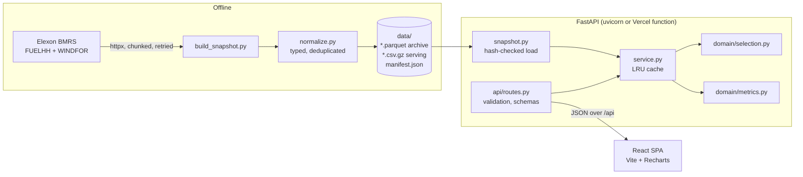
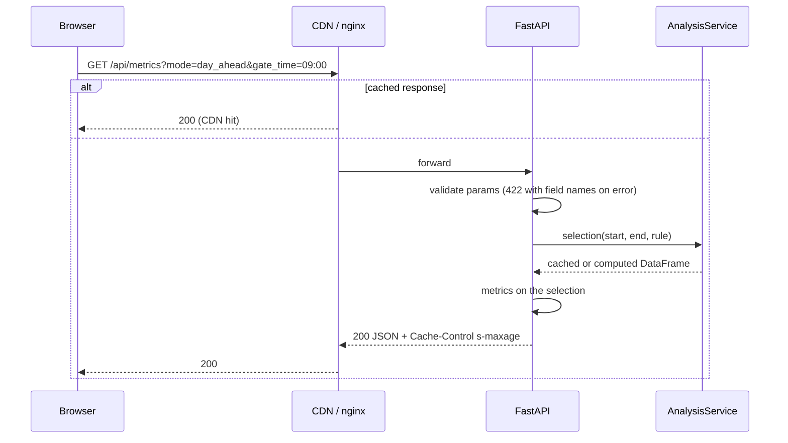
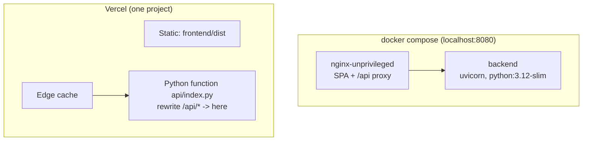

# Architecture

## Overview

The app has three parts: an offline snapshot builder, a Python API, and a React single-page
app. The builder runs on a developer machine (or in a future scheduled job). The API and the
SPA are what users hit.

## Layers

| Layer | Modules | Rule |
|---|---|---|
| Ingestion | `ingest/elexon_client.py`, `ingest/normalize.py`, `ingest/scope.py` | Only place that talks to Elexon. Runs offline. |
| Domain | `domain/selection.py`, `domain/metrics.py` | Pure functions over DataFrames. No I/O, no HTTP. All the business logic lives here. |
| Service | `service.py`, `snapshot.py` | Loads the snapshot once, caches computed selections. |
| HTTP | `api/routes.py`, `api/schemas.py`, `main.py`, `http_cache.py`, `observability.py` | Validation, response models, caching headers, logging. Thin. |
| UI | `frontend/src` | Typed client generated from the API schema; components only render. |

The domain layer has no idea it is behind an API, which is why it can be tested with tiny
hand-built tables and why the lead-time curve can simply call the selection 48 times.

## The core rule

For a target slot `T` the forecast "available at decision time" is the one with the latest
`publishTime <= cutoff(T)`:

- **Day-ahead mode:** `cutoff(T)` is the gate time (default 09:00) on the UK calendar day
  before `T`'s UK delivery day. Worked out in local wall-clock time, so clock changes are
  handled.
- **Horizon mode:** `cutoff(T) = T - H` hours, 0 to 48.

This matters because every WINDFOR publish also restates up to ~25 hours of slots that have
already started. Taking "the latest forecast per slot" without a cutoff would use forecasts
published after the fact.

## Request flow

## Data

| File | Rows | Used by |
|---|---|---|
| `data/actuals.csv.gz` | 1,488 half-hours | API (serving copy) |
| `data/forecasts.csv.gz` | 19,856 (272 publishes × 73 hours) | API (serving copy) |
| `data/*.parquet` | same | Analysis, archive; checked equal to the CSV in tests |
| `data/manifest.json` | – | Scope, request log, hashes, data-quality summary |

All timestamps are stored in UTC and converted to Europe/London only for display and for the
day-ahead calendar logic.

## Deployment

Both run the same FastAPI app object. Docker reads the snapshot from `/app/data`; Vercel
bundles `data/*.csv.gz` and `manifest.json` into the function.

## Testing

- **Backend (pytest, 142 tests, ~98% coverage):** selection rule edge cases (one minute after
  cutoff, exactly at cutoff, clock changes, missing data), a lookahead audit that re-derives
  every January selection with a naive loop, metrics on hand-computed datasets,
  normalisation on real Elexon response fixtures, client retries with mocked HTTP, API
  validation and caching, snapshot integrity.
- **Frontend (vitest + Testing Library, 42 tests):** controls, API client error handling, URL
  filter parsing, KPI wording, histogram binning, axis ticks.
- **End to end:** `scripts/verify_deploy.sh` checks a running deployment and compares its
  `/api/metrics` with a local computation.
